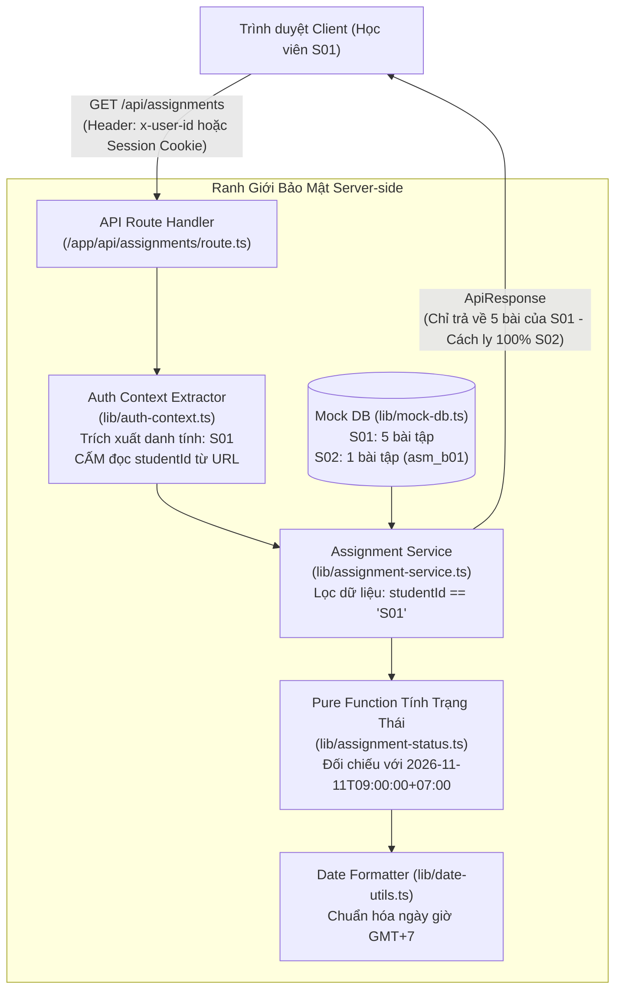

# 🏛️ ARCHITECTURE SPEC & API CONTRACT — IELTS MASTER E-LEARNING
## CHỨC NĂNG: "BÀI TẬP CỦA TÔI" (DÀNH CHO HỌC VIÊN S01)

> **Dự án:** IELTS Master E-Learning Platform  
> **Chức năng:** "Bài tập của tôi" dành cho học viên S01 (`Lương Lý Anh Tú`)  
> **Thời điểm đối chiếu hệ thống:** `2026-11-11T09:00:00+07:00` (`11/11/2026, 09:00 GMT+7`)  
> **Tài liệu tham chiếu:** [DESIGN_SPEC.md](DESIGN_SPEC.md) & [VOICE_GUIDE.md](VOICE_GUIDE.md)  
> **Người thực hiện:** Subagent `architect` (Quy trình chuẩn GEMINI.md)  
> **Đối tượng bàn giao:** Subagent `backend`, Subagent `frontend`, Subagent `api-tester`  

---

## 1. TỔNG QUAN KIẾN TRÚC & MỤC TIÊU HỆ THỐNG

1. **Phương pháp tiếp cận API-Contract-First:**
   - Schema dữ liệu được định nghĩa bằng TypeScript interfaces chặt chẽ (`types.ts`), khóa cứng tên trường (`id`, `studentId`, `dueDate`, `submittedAt`, `status`, `isLate`, `statusLabel`, `lateLabel`), triệt tiêu 100% lỗi sai lệch dữ liệu giữa Backend và Frontend.
2. **Kiến trúc Zero-Trust & Chống rò rỉ dữ liệu S02 (IDOR / BOLA Prevention):**
   - Tuyệt đối **không** dùng `studentId` từ URL path hoặc query string làm phương thức xác thực danh tính.
   - Nhận diện học viên hoàn toàn từ **Server-side Session / Auth Context** (mặc định giả lập an toàn `S01`).
   - Lọc dữ liệu nghiêm ngặt ở Service Layer: `db.filter(a => a.studentId === currentStudentId)`. Dữ liệu bài tập của học viên S02 (`asm_b01`) không bao giờ được xuất hiện trong API response.
3. **Logic nghiệp vụ thuần túy (Pure Function):**
   - Hàm `calculateAssignmentStatus` được tách biệt hoàn toàn khỏi I/O, thời gian hệ thống và framework, cho phép kiểm thử tự động (Unit Test) chạy tức thì với 100% độ chính xác.
4. **Tuân thủ Luật 8 (Mỗi file $\le 200$ dòng):**
   - Phân tách rõ ràng giữa Core Logic (`lib/`), API Handler (`app/api/`), UI Components (`components/`), Types (`types/`), và Tests (`tests/`).

---

## 2. SƠ ĐỒ DÒNG CHẢY DỮ LIỆU & BẢO MẬT (DATA FLOW)



---

## 3. KHÓA CHẶN SCHEMA DỮ LIỆU & API CONTRACT (`types.ts`)

File hợp đồng dữ liệu chuẩn đã được tạo tại `types.ts`:

### 3.1. Các kiểu dữ liệu cốt lõi (Domain Types)
```typescript
// Kỹ năng trong IELTS
export type SkillType = 'Writing' | 'Reading' | 'Listening' | 'Speaking';

// Trạng thái bài tập chuẩn hệ thống
export type AssignmentStatus = 'NOT_SUBMITTED' | 'OVERDUE' | 'SUBMITTED';

// Nhãn hiển thị tiếng Việt chuẩn theo VOICE_GUIDE
export type StatusLabel = 'Chưa nộp' | 'Quá hạn' | 'Đã nộp';
export type LateLabel = 'Nộp trễ' | null;

// Bộ lọc trên giao diện
export type AssignmentFilter = 'ALL' | 'NOT_SUBMITTED' | 'SUBMITTED' | 'OVERDUE';
```

### 3.2. Thực thể dữ liệu thô & View Model
```typescript
// Thực thể bài tập thô trong DB
export interface Assignment {
  id: string;                 // VD: 'asm_01'
  code: string;               // VD: 'IELTS-W1-01'
  studentId: string;          // VD: 'S01' | 'S02'
  title: string;              // Tên bài tập
  skill: SkillType;           // 'Writing' | 'Reading' | 'Listening' | 'Speaking'
  description?: string;       // Mô tả / Đề bài
  dueDate: string;            // ISO 8601: '2026-11-09T23:59:00+07:00'
  submittedAt: string | null; // ISO 8601 hoặc null nếu chưa nộp
}

// Thực thể bài tập làm giàu cho Frontend hiển thị
export interface AssignmentWithStatus extends Assignment {
  status: AssignmentStatus;
  isLate: boolean;
  statusLabel: StatusLabel;
  lateLabel: LateLabel;
  formattedDueDate: string;         // '09/11/2026 23:59'
  formattedSubmittedAt: string | null; // '09/11/2026 21:15' hoặc null
}
```

### 3.3. Hợp đồng API Response (`ApiResponse<T>`)
```typescript
export interface StudentInfo {
  id: string;          // 'S01'
  name: string;        // 'Lương Lý Anh Tú'
  email?: string;
  targetBand?: string; // '7.5'
}

export interface ApiResponse<T> {
  success: boolean;
  data: T;
  error: string | null;
  simulatedNow: string;       // '2026-11-11T09:00:00+07:00'
  studentInfo: StudentInfo;
}
```

---

## 4. BẢO MẬT SERVER-SIDE AUTHENTICATION & PHÒNG CHỐNG IDOR / BOLA

### 4.1. Phân tích rủi ro bảo mật IDOR / BOLA
- **Lỗ hổng thường gặp:** Thiết kế endpoint `/api/students/{studentId}/assignments` hoặc nhận diện qua query `?studentId=S02`. Kẻ tấn công hoặc học viên S01 có thể sửa tham số thành `S02` để xem trộm bài nộp của học viên khác.
- **Quy tắc bắt buộc:** **Tuyệt đối không lấy `studentId` từ URL/Query để xác thực.**

### 4.2. Cơ chế xác thực danh tính (`lib/auth-context.ts`)
1. **Endpoint duy nhất:** `GET /api/assignments` (hoặc `GET /api/me/assignments`).
2. **Nguồn gốc danh tính (Identity Source):**
   - Đọc từ Server Session (Session Token / Cookie) hoặc Header nội bộ `x-user-id` (giả lập gateway xác thực).
   - Mặc định an toàn cho môi trường thử nghiệm: Fallback cứng về học viên `S01` (`Lương Lý Anh Tú`).
   - Nếu Client cố tình truyền `?studentId=S02` trong query params, hệ thống sẽ **bỏ qua hoàn toàn** hoặc từ chối truy cập (403 Forbidden).

### 4.3. Lớp Dịch vụ Cách ly Dữ liệu (`lib/assignment-service.ts`)
```typescript
export class AssignmentService {
  /**
   * Truy vấn bài tập - Bắt buộc lọc theo studentId từ Server-side Auth Context
   * Tuyệt đối không cho phép query toàn bộ bảng mà không có điều kiện studentId.
   */
  static getAssignmentsForStudent(currentStudentId: string, simulatedNow?: string): AssignmentWithStatus[] {
    // 1. Lọc nghiêm ngặt từ nguồn dữ liệu
    const studentAssignments = mockDb.assignments.filter(
      (item) => item.studentId === currentStudentId
    );

    // 2. Tính toán trạng thái và định dạng cho từng bài tập
    return studentAssignments.map((assignment) => {
      const statusResult = calculateAssignmentStatus({
        dueDate: assignment.dueDate,
        submittedAt: assignment.submittedAt,
        simulatedNow: simulatedNow || SIMULATED_SYSTEM_NOW,
      });

      return {
        ...assignment,
        ...statusResult,
        formattedDueDate: formatDateVietnam(assignment.dueDate),
        formattedSubmittedAt: assignment.submittedAt ? formatDateVietnam(assignment.submittedAt) : null,
      };
    });
  }
}
```

### 4.4. Kịch bản kiểm thử rò rỉ dữ liệu S02 (BOLA Verification Test Case)
- **Tập dữ liệu giả lập (`lib/mock-db.ts`):**
  - Chứa 5 bài tập thuộc quyền sở hữu của `S01` (`asm_01` $\rightarrow$ `asm_05`).
  - Chứa 1 bài tập bảo mật thuộc quyền sở hữu của `S02` (`asm_b01` - B01 của `Trần Thị Bích`).
- **Điều kiện Pass:**
  - Gọi `GET /api/assignments` với ngữ cảnh học viên `S01` $\rightarrow$ Nhận đúng 5 bài tập, mảng kết quả **0% chứa `asm_b01`**.
  - Kiểm tra `response.data.every(item => item.studentId === 'S01') === true`.

---

## 5. THIẾT KẾ PURE FUNCTION TÍNH TRẠNG THÁI (`lib/assignment-status.ts`)

### 5.1. Định nghĩa Hàm thuần túy
Hàm không có side-effect, nhận vào đầy đủ tham số đầu vào và trả về kết quả dự đoán được 100%:

```typescript
export interface CalculateStatusParams {
  dueDate: string;            // ISO 8601 (VD: '2026-11-09T23:59:00+07:00')
  submittedAt: string | null; // ISO 8601 hoặc null
  simulatedNow?: string;      // Mặc định: '2026-11-11T09:00:00+07:00'
}

export function calculateAssignmentStatus(params: CalculateStatusParams): AssignmentStatusResult {
  const nowStr = params.simulatedNow || '2026-11-11T09:00:00+07:00';
  const nowMs = Date.parse(nowStr);
  const dueMs = Date.parse(params.dueDate);

  if (isNaN(nowMs) || isNaN(dueMs)) {
    throw new Error('Invalid ISO date string provided');
  }

  // Nhánh 1: Học viên ĐÃ NỘP BÀI
  if (params.submittedAt !== null && params.submittedAt !== undefined) {
    const submitMs = Date.parse(params.submittedAt);
    if (isNaN(submitMs)) {
      throw new Error('Invalid submittedAt date string');
    }

    const isLate = submitMs > dueMs;
    return {
      status: 'SUBMITTED',
      isLate: isLate,
      statusLabel: 'Đã nộp',
      lateLabel: isLate ? 'Nộp trễ' : null,
    };
  }

  // Nhánh 2: Học viên CHƯA NỘP BÀI
  const isOverdue = nowMs > dueMs;
  if (isOverdue) {
    return {
      status: 'OVERDUE',
      isLate: true,
      statusLabel: 'Quá hạn',
      lateLabel: null,
    };
  }

  return {
    status: 'NOT_SUBMITTED',
    isLate: false,
    statusLabel: 'Chưa nộp',
    lateLabel: null,
  };
}
```

### 5.2. Xử lý Múi giờ GMT+7 & Định dạng ngày giờ (`lib/date-utils.ts`)
- `Date.parse(isoString)` phân giải chuỗi ISO 8601 có offset `+07:00` thành số nguyên Unix Milliseconds (UTC) độc lập với múi giờ của máy trạm.
- Việc so sánh `submitMs > dueMs` và `nowMs > dueMs` là so sánh số nguyên tuyệt đối, không bị ảnh hưởng bởi múi giờ máy chạy test.
- Khi format chuỗi hiển thị giao diện:
  ```typescript
  export function formatDateVietnam(isoString: string): string {
    const date = new Date(isoString);
    // Định dạng: DD/MM/YYYY HH:mm theo múi giờ Asia/Ho_Chi_Minh
    return new Intl.DateTimeFormat('vi-VN', {
      timeZone: 'Asia/Ho_Chi_Minh',
      day: '2-digit',
      month: '2-digit',
      year: 'numeric',
      hour: '2-digit',
      minute: '2-digit',
      hour12: false,
    }).format(date);
  }
  ```

### 5.3. Bảng Kiểm Thử Chuẩn Hóa (Test Matrix) Cho Subagent `api-tester`

Mốc hệ thống: `2026-11-11T09:00:00+07:00`

| Mã bài | Hạn nộp (`dueDate`) | Ngày nộp (`submittedAt`) | Trạng thái (`status`) | Nộp trễ (`isLate`) | Nhãn trạng thái (`statusLabel`) | Nhãn phụ (`lateLabel`) |
| :--- | :--- | :--- | :--- | :---: | :--- | :--- |
| `asm_01` | `2026-11-09T23:59:00+07:00` | `2026-11-09T21:15:00+07:00` | `SUBMITTED` | `false` | `Đã nộp` | `null` |
| `asm_02` | `2026-11-10T23:59:00+07:00` | `2026-11-11T08:15:00+07:00` | `SUBMITTED` | `true` | `Đã nộp` | `Nộp trễ` |
| `asm_03` | `2026-11-10T12:00:00+07:00` | `null` | `OVERDUE` | `true` | `Quá hạn` | `null` |
| `asm_04` | `2026-11-12T23:59:00+07:00` | `null` | `NOT_SUBMITTED` | `false` | `Chưa nộp` | `null` |
| `asm_05` | `2026-11-15T18:00:00+07:00` | `null` | `NOT_SUBMITTED` | `false` | `Chưa nộp` | `null` |
| *Biên 1* | `2026-11-11T09:00:00+07:00` | `2026-11-11T09:00:00+07:00` | `SUBMITTED` | `false` | `Đã nộp` | `null` |
| *Biên 2* | `2026-11-11T09:00:00+07:00` | `null` (now = due) | `NOT_SUBMITTED` | `false` | `Chưa nộp` | `null` |

---

## 6. CẤU TRÚC THƯ MỤC CHI TIẾT & BẢO ĐẢM LUẬT 8 ($\le 200$ DÒNG/FILE)

Dự án được phân rã thành các module độc lập, kích thước nhỏ gọn và tuân thủ nguyên tắc Single Responsibility:

```
ielts-master-assignment/
├── types.ts                               # Khóa cứng Types & Interfaces (~80 dòng)
├── DESIGN_SPEC.md                         # Đặc tả thiết kế UI & Voice Guide
├── ARCHITECTURE_SPEC.md                   # Tài liệu kiến trúc & API Contract (File này)
│
├── lib/                                   # [Backend] Core Logic & Data Layer
│   ├── auth-context.ts                    # Trích xuất Server-side Session (~60 dòng)
│   ├── assignment-status.ts               # Pure function tính trạng thái (~70 dòng)
│   ├── date-utils.ts                      # Format ngày giờ GMT+7 (~50 dòng)
│   ├── mock-db.ts                         # Dữ liệu mẫu S01 và S02 (~120 dòng)
│   └── assignment-service.ts              # Service lọc dữ liệu S01 IDOR-free (~85 dòng)
│
├── app/                                   # [Next.js App Router]
│   ├── api/
│   │   └── assignments/
│   │       └── route.ts                   # API Endpoint GET /api/assignments (~65 dòng)
│   ├── layout.tsx                         # Khung layout ứng dụng (~45 dòng)
│   └── page.tsx                           # Trang chính "Bài tập của tôi" (~50 dòng)
│
├── components/                            # [Frontend] UI Components (pbakaus/impeccable)
│   ├── assignment-header.tsx              # Tiêu đề H1, tên học viên, nút Làm mới (~60 dòng)
│   ├── assignment-benchmark-banner.tsx    # Banner mốc 11/11/2026 09:00 (~45 dòng)
│   ├── assignment-filter-tabs.tsx         # Thanh tabs lọc bài & đếm số lượng (~70 dòng)
│   ├── assignment-status-badge.tsx        # 4 loại huy hiệu trạng thái chuẩn Impeccable (~65 dòng)
│   ├── assignment-table-desktop.tsx       # Bảng Desktop chuẩn căn lề, tabular-nums (~130 dòng)
│   ├── assignment-card-mobile.tsx         # Danh sách thẻ Mobile cảm ứng 44px (~120 dòng)
│   └── assignment-view.tsx                # Container quản lý state & toggle Desktop/Mobile (~140 dòng)
│
└── tests/                                 # [Testing] Bộ kiểm thử tự động
    ├── assignment-status.test.ts          # Unit test Pure function 5 case + 2 edge case (~120 dòng)
    ├── assignment-service.test.ts         # Unit test IDOR: Cấm lọt B01 của S02 (~80 dòng)
    └── api-route.test.ts                  # Test HTTP Endpoint GET /api/assignments (~80 dòng)
```

### Bảng Kiểm Soát Giới Hạn Dòng (Rule 8 Compliance Table)
| Tên File | Mục đích / Trách nhiệm | Dòng dự kiến | Giới hạn Luật 8 | Phụ trách |
| :--- | :--- | :---: | :---: | :--- |
| `types.ts` | Schema dữ liệu & API Contract | 75 | $\le 200$ | `architect` (Đã xong) |
| `lib/auth-context.ts` | Server-side Session & IDOR Guard | ~60 | $\le 200$ | `backend` |
| `lib/assignment-status.ts` | Pure Function tính trạng thái | ~70 | $\le 200$ | `backend` |
| `lib/date-utils.ts` | Format GMT+7 độc lập OS | ~50 | $\le 200$ | `backend` |
| `lib/mock-db.ts` | Dữ liệu mẫu S01 (5 bài) & S02 (1 bài) | ~120 | $\le 200$ | `backend` |
| `lib/assignment-service.ts` | Lọc dữ liệu chống rò rỉ S02 | ~85 | $\le 200$ | `backend` |
| `app/api/assignments/route.ts` | Endpoint GET /api/assignments | ~65 | $\le 200$ | `backend` |
| `components/assignment-header.tsx` | Header bar chuẩn Voice Guide | ~60 | $\le 200$ | `frontend` |
| `components/assignment-benchmark-banner.tsx` | Banner mốc thời gian đối chiếu | ~45 | $\le 200$ | `frontend` |
| `components/assignment-filter-tabs.tsx` | Tabs lọc bài & đếm số lượng | ~70 | $\le 200$ | `frontend` |
| `components/assignment-status-badge.tsx` | 4 Badge màu WCAG AAA | ~65 | $\le 200$ | `frontend` |
| `components/assignment-table-desktop.tsx` | Table Desktop căn lề chuẩn | ~130 | $\le 200$ | `frontend` |
| `components/assignment-card-mobile.tsx` | Card Mobile cảm ứng $\ge 44px$ | ~120 | $\le 200$ | `frontend` |
| `components/assignment-view.tsx` | Client Orchestrator & State | ~140 | $\le 200$ | `frontend` |
| `tests/assignment-status.test.ts` | Test Pure Function | ~120 | $\le 200$ | `api-tester` |
| `tests/assignment-service.test.ts` | Test cách ly dữ liệu S02 | ~80 | $\le 200$ | `api-tester` |

---

## 7. MẪU DỮ LIỆU PHẢN HỒI JSON CHUẨN (GOLDEN API RESPONSE SAMPLE)

```json
{
  "success": true,
  "data": [
    {
      "id": "asm_01",
      "code": "IELTS-W1-01",
      "studentId": "S01",
      "title": "IELTS Writing Task 1: Phân tích biểu đồ năng lượng tái tạo",
      "skill": "Writing",
      "description": "The chart below shows the proportion of electricity generated from renewable sources in four countries between 2010 and 2025.",
      "dueDate": "2026-11-09T23:59:00+07:00",
      "submittedAt": "2026-11-09T21:15:00+07:00",
      "status": "SUBMITTED",
      "isLate": false,
      "statusLabel": "Đã nộp",
      "lateLabel": null,
      "formattedDueDate": "09/11/2026 23:59",
      "formattedSubmittedAt": "09/11/2026 21:15"
    },
    {
      "id": "asm_02",
      "code": "IELTS-W2-03",
      "studentId": "S01",
      "title": "IELTS Writing Task 2: Nghị luận về trí tuệ nhân tạo và thị trường lao động",
      "skill": "Writing",
      "description": "Some people believe that artificial intelligence will create more jobs than it eliminates. To what extent do you agree or disagree?",
      "dueDate": "2026-11-10T23:59:00+07:00",
      "submittedAt": "2026-11-11T08:15:00+07:00",
      "status": "SUBMITTED",
      "isLate": true,
      "statusLabel": "Đã nộp",
      "lateLabel": "Nộp trễ",
      "formattedDueDate": "10/11/2026 23:59",
      "formattedSubmittedAt": "11/11/2026 08:15"
    },
    {
      "id": "asm_03",
      "code": "IELTS-R3-02",
      "studentId": "S01",
      "title": "IELTS Reading: Luyện đọc chuyên sâu chủ đề Lịch sử tiến hóa của cá voi",
      "skill": "Reading",
      "description": "Academic Reading Passage 3 - The Evolutionary History of Cetaceans and Modern Marine Mammals.",
      "dueDate": "2026-11-10T12:00:00+07:00",
      "submittedAt": null,
      "status": "OVERDUE",
      "isLate": true,
      "statusLabel": "Quá hạn",
      "lateLabel": null,
      "formattedDueDate": "10/11/2026 12:00",
      "formattedSubmittedAt": null
    },
    {
      "id": "asm_04",
      "code": "IELTS-L4-01",
      "studentId": "S01",
      "title": "IELTS Listening: Section 4 - Dự án bảo tồn đa dạng sinh học đô thị",
      "skill": "Listening",
      "description": "Complete the notes below. Write NO MORE THAN TWO WORDS AND/OR A NUMBER for each answer.",
      "dueDate": "2026-11-12T23:59:00+07:00",
      "submittedAt": null,
      "status": "NOT_SUBMITTED",
      "isLate": false,
      "statusLabel": "Chưa nộp",
      "lateLabel": null,
      "formattedDueDate": "12/11/2026 23:59",
      "formattedSubmittedAt": null
    },
    {
      "id": "asm_05",
      "code": "IELTS-S2-04",
      "studentId": "S01",
      "title": "IELTS Speaking Part 2: Thu âm bài nói chủ đề Chuyến đi đáng nhớ",
      "skill": "Speaking",
      "description": "Describe a memorable journey you have made by public transport. You should say: where you went, what happened, and explain why it was memorable.",
      "dueDate": "2026-11-15T18:00:00+07:00",
      "submittedAt": null,
      "status": "NOT_SUBMITTED",
      "isLate": false,
      "statusLabel": "Chưa nộp",
      "lateLabel": null,
      "formattedDueDate": "15/11/2026 18:00",
      "formattedSubmittedAt": null
    }
  ],
  "error": null,
  "simulatedNow": "2026-11-11T09:00:00+07:00",
  "studentInfo": {
    "id": "S01",
    "name": "Lương Lý Anh Tú",
    "email": "anhtu.luong@ieltsmaster.edu.vn",
    "targetBand": "7.5"
  }
}
```

---

## 8. HƯỚNG DẪN BÀN GIAO CHO CÁC SUBAGENT TIẾP THEO

1. **Cho Subagent `backend`:**
   - Đọc trực tiếp [types.ts](types.ts) và mục 3, 4, 5 của tài liệu này.
   - Viết các module trong `lib/` (`auth-context.ts`, `assignment-status.ts`, `date-utils.ts`, `mock-db.ts`, `assignment-service.ts`) và `app/api/assignments/route.ts`.
   - Bảo đảm tuyệt đối không dùng studentId từ URL làm xác thực, cách ly 100% bài tập `asm_b01` của S02.
   - Tuân thủ Luật 8 ($\le 200$ dòng/file).
2. **Cho Subagent `frontend`:**
   - Đọc [DESIGN_SPEC.md](DESIGN_SPEC.md) và [types.ts](types.ts).
   - Sử dụng đúng các kiểu `AssignmentWithStatus`, `AssignmentFilter`, `ApiResponse`.
   - Thiết kế giao diện 2 chế độ: Table căn lề chuẩn (`TanStack/table` & `shadcn/ui` style) trên Desktop ($\ge 768px$) và Card List cảm ứng ($\ge 44px$) trên Mobile ($< 768px$).
   - Đảm bảo 0% lỗi F12 Console.
3. **Cho Subagent `api-tester`:**
   - Dựa vào Bảng Test Matrix tại mục 5.3 và kịch bản IDOR tại mục 4.4 để viết unit test và integration test.
   - Xác minh exit code = 0 trước khi báo cáo hoàn thành.
