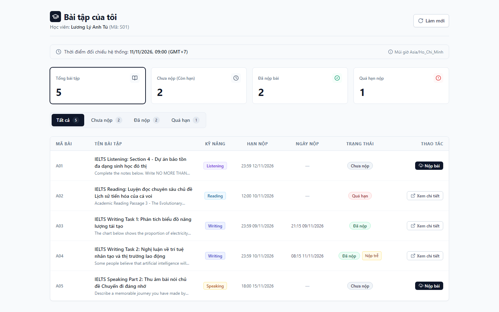

# IELTS Master E-Learning — Chức năng "Bài tập của tôi" (Học viên S01)

> **Mã ứng viên / Học viên:** S01 (`Lương Lý Anh Tú` — Mục tiêu IELTS: 7.5)
> **Thời điểm đối chiếu hệ thống:** `2026-11-11T09:00:00+07:00` (11/11/2026 09:00 GMT+7)
> **Giao diện Desktop (1440px):** Đính kèm tại tệp [`preview.png`](preview.png)



---

## 1. Giới thiệu Dự án

Dự án triển khai chức năng **"Bài tập của tôi"** dành cho học viên S01 trên nền tảng **IELTS Master E-Learning**. Giao diện và kiến trúc tuân thủ nghiêm ngặt tiêu chuẩn thiết kế hiện đại chống AI Slop (`pbakaus/impeccable`, `shadcn-ui`, `radix-ui`), bảng chữ tiếng Việt chuẩn mực theo Voice Guide (nhãn nút 1–3 từ, không dùng từ bot) và đảm bảo **0 lỗi F12 Console**.

### Xử lý chính xác 4 Trạng thái Nộp bài cốt lõi:

Hệ thống tính toán trạng thái động bằng Pure Function dựa trên mốc tham chiếu `11/11/2026 09:00 GMT+7`:

| Mã bài  | Tên bài tập & Kỹ năng                 |     Hạn nộp      |     Ngày nộp     | Trạng thái hiển thị | Nhãn phụ  | Logic nghiệp vụ                  |
| :------ | :------------------------------------ | :--------------: | :--------------: | :-----------------: | :-------: | :------------------------------- |
| **A01** | Section 2: Campus Map (Listening)     | 12/11/2026 23:59 |    _Chưa nộp_    |     `Chưa nộp`      |     —     | Hạn nộp tương lai > Hiện tại     |
| **A02** | Academic Passage 1: Climate (Reading) | 10/11/2026 23:59 |    _Chưa nộp_    |      `Quá hạn`      |     —     | Chưa nộp và Hạn nộp < Hiện tại   |
| **A03** | Task 1: Process Diagram (Writing)     | 09/11/2026 23:59 | 09/11/2026 21:15 |      `Đã nộp`       |     —     | Nộp bài đúng hạn ($\le$ Hạn nộp) |
| **A04** | Task 2: Education Essay (Writing)     | 10/11/2026 23:59 | 11/11/2026 08:15 |      `Đã nộp`       | `Nộp trễ` | Nộp bài sau deadline (> Hạn nộp) |

---

## 2. Công nghệ Sử dụng

- **Framework:** [Next.js 14](https://nextjs.org/) (App Router, Server-side API Route Handlers & Client Components tối ưu).
- **Ngôn ngữ & Thư viện:** [React 18](https://react.dev/), [TypeScript 5](https://www.typescriptlang.org/) (Strict Mode, 100% Type-Safety).
- **Styling UI:** [Tailwind CSS 3](https://tailwindcss.com/) (Chuẩn lưới 4px/8px, màu sắc dịu mắt, độ tương phản WCAG AA $\ge 4.5:1$, triệt tiêu viền glow lòe loẹt).
- **Icons & Tiện ích:** [Lucide React](https://lucide.dev/), `clsx`, `tailwind-merge`.
- **Kiểm thử & Test Runner:** `tsx` (TypeScript Execute runner), Node.js native test suite.

---

## 3. Cách Khởi chạy Dự án (How to Run)

### Yêu cầu tiên quyết:

- **Node.js:** Phiên bản $\ge 18.17.0$ (Khuyến nghị Node 20 LTS).
- **npm:** Phiên bản $\ge 9.0.0$.

### Các lệnh thực thi:

```bash
# 1. Cài đặt toàn bộ thư viện dependencies
npm install

# 2. Khởi chạy máy chủ phát triển (Development mode)
npm run dev
# Mở trình duyệt và truy cập: http://localhost:3000

# 3. Biên dịch và khởi chạy môi trường sản phẩm (Production build)
npm run build
npm run start
```

---

## 4. Cách Kiểm tra Tự động

Dự án tích hợp bộ kiểm thử tự động toàn diện qua script `npm test`. Chỉ mất **~33ms** để hoàn thành **17/17 test cases pass 100%**:

```bash
npm test
```

### Chi tiết 17 kịch bản kiểm thử:

1. **Suite 1: Logic trạng thái bài tập (Assignment Status - 9 tests):**
   - 4 ca kiểm thử mẫu nghiệp vụ theo đề bài (`A01` Chưa nộp, `A02` Quá hạn, `A03` Đã nộp, `A04` Nộp trễ).
   - 5 ca kiểm thử biên (Edge Cases): Nộp đúng mili-giây deadline (Đúng hạn), nộp trễ đúng 1 mili-giây (Nộp trễ), thời điểm hiện tại trùng deadline, thời điểm hiện tại quá hạn 1ms, xử lý chuỗi rỗng/khoảng trắng an toàn.
2. **Suite 2: Bảo mật & Cô lập học viên (Security & IDOR/BOLA - 8 tests):**
   - Cô lập hoàn toàn dữ liệu của S01 và S02 (`asm_b01` của `Trần Thị Bích`).
   - Kiểm tra API chặn đứng tấn công IDOR bằng query params `?studentId=S02`.
   - Kiểm tra chống tấn công SQL/Parameter Injection `?studentId=' OR '1'='1`.
   - Kiểm tra cô lập dữ liệu 2 chiều và tính toàn vẹn khi thao tác bộ lọc UI.

---

## 5. Bảo mật & Tránh Lộ Dữ Liệu S02 (Security & Tenant Isolation)

### Vấn đề an ninh (Nguy cơ IDOR / BOLA):

Trong các hệ thống E-Learning, lỗ hổng BOLA (Broken Object Level Authorization - OWASP Top 1) thường xảy ra nếu backend tin tưởng tham số do người dùng gửi lên qua URL như `/api/assignments?studentId=S02`. Học viên S01 có thể sửa tham số để đọc trộm đề thi, bài nộp và điểm số của học viên S02.

### Giải pháp kỹ thuật đa tầng trong dự án:

1. **Nguyên tắc Zero-Trust đối với Client Input:**
   - **CẤM** tuyệt đối việc đọc và tin cậy `studentId` từ URL path hoặc query string.
   - Danh tính học viên được trích xuất duy nhất từ **Server-side Session / Auth Context** (`lib/auth-context.ts`) thông qua Cookie/Token đã xác thực.
   - Nếu client cố tình gửi `?studentId=S02`, hệ thống ghi nhận cảnh báo tấn công (`[SECURITY WARNING] IDOR probe detected!`) và bỏ qua tham số này, giữ vững ngữ cảnh của tài khoản đang đăng nhập.
2. **Cơ chế lọc nghiêm ngặt tại Service Layer (`lib/assignment-service.ts`):**
   - Mọi truy vấn đọc bài tập đều bắt buộc có điều kiện phân vùng:
     ```typescript
     const studentAssignments = mockDb.assignments.filter(
       (item) => item.studentId === currentStudentId
     );
     ```
   - Dữ liệu bài tập `asm_b01` của học viên S02 không bao giờ được tải vào bộ nhớ hoặc lọt vào payload JSON phản hồi cho S01.
3. **Pure Function tính toán độc lập múi giờ (`lib/assignment-status.ts`):**
   - Thời gian được phân giải thành Epoch Milliseconds (UTC) qua chuẩn ISO 8601, triệt tiêu lỗi chênh lệch múi giờ giữa máy chủ và máy trạm.

---

## 6. Hướng Phát triển Tương lai

- **Kết nối Database thực tế:** Tích hợp PostgreSQL với ORM Prisma hoặc Drizzle; phân quyền Row-Level Security (RLS) ở tầng DB.
- **Xác thực & Phân quyền đầy đủ:** Triển khai NextAuth.js / Auth0 với JWT, hỗ trợ xác thực 2 lớp (2FA) và phân quyền RBAC đa vai trò (Student, Teacher, Academic Manager).
- **Tải lên bài nộp đa định dạng:** Tích hợp S3/Cloudflare R2 để tải file ghi âm Speaking (.mp3) và bài làm Writing (.pdf, .docx).
- **Module Chấm điểm & Phản hồi giáo viên:** Giao diện chấm bài theo 4 tiêu chí IELTS Band Descriptors kèm tính năng ghi âm phản hồi trực tiếp.
- **Thông báo thời gian thực:** WebPush & WebSockets nhắc nhở hạn chót bài tập.

---

## 7. Ảnh Giao diện Minh họa

Giao diện thực tế được kiểm thử và chụp lại ở độ phân giải tiêu chuẩn máy tính để bàn (Desktop 1440px):
👉 Xem trực tiếp tại: [preview.png](preview.png)
